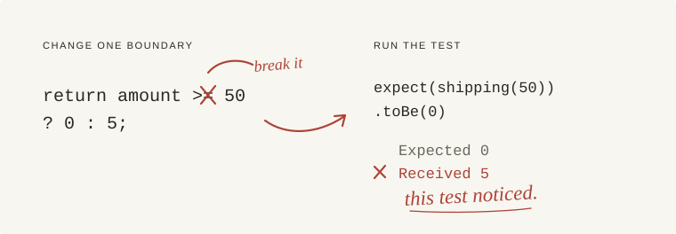

<p align="center">
  = 50. The shipping test at exactly 50 fails: expected 0, received 5. A note reads: this test noticed.">
</p>

<h1 align="center">canfail</h1>

<p align="center"><strong>Stop your AI agent from writing useless tests.</strong></p>

canfail is a skill for coding agents, with a checker for JavaScript and TypeScript. It asks the agent to test behavior that matters, use the real code, and check that the tests notice when that code breaks.

A test should earn its place in your repo. If it only checks a mock it called itself, repeats the implementation, or passes for any output, it adds maintenance without much protection. canfail is here to keep those tests out.

[Install](#install) · [Try the demo](#try-the-demo) · [CLI reference](docs/cli.md)

## The kind of test we mean

This passes. You could delete the checkout implementation and it would still pass.

```ts
it("sends a receipt", () => {
  const sendReceipt = vi.fn();
  sendReceipt("ada@example.com");
  expect(sendReceipt).toHaveBeenCalledWith("ada@example.com");
});
```

Call the real checkout instead. Keep the mail server fake; check that **checkout** uses it correctly.

```ts
it("sends the paid receipt", async () => {
  const mailer = { sendReceipt: vi.fn(async () => {}) };
  const purchase = order();
  const receipt = await checkout(purchase, fakeGateway(), mailer);
  expect(receipt).toEqual({ status: "paid", total: 37.4, chargeId: "ch_1" });
  expect(mailer.sendReceipt).toHaveBeenCalledExactlyOnceWith(purchase.email, receipt);
});
```

These snippets use the fixtures from the [checkout example](examples/checkout/tests/after/checkout.test.ts). The difference is whether a broken checkout can make the test fail.

## Install

**Claude Code** gets the skill and a hook that scans test files after the agent writes or edits them. Run these as two separate prompts:

```text
/plugin marketplace add ykakade/canfail
```

```text
/plugin install canfail@canfail
```

**Other agents that support skills:**

```bash
npx skills add ykakade/canfail
```

For agents that read a project rules file, merge the rules in [`AGENTS.md`](AGENTS.md) into yours. Keep your existing project instructions.

Then give the agent a normal task. The [skill](skills/canfail/SKILL.md) tells it how to choose and check tests; the automatic scan hook is Claude Code only.

**To try the checker on its own**, run this in a JavaScript or TypeScript project. Node 18+ is required; the checker has no runtime dependencies.

```bash
npx github:ykakade/canfail scan
```

That only reads test files. To plant bugs and see whether the tests catch them:

```bash
npx github:ykakade/canfail prove src/cart.ts --cmd "npm test"
```

## What it asks of the agent

- Read the existing tests before adding more. Extend a useful case instead of duplicating it.
- Name the behavior a test protects and the mistake it would catch. Skip tests of trivial wiring or language behavior when they add no protection.
- Run the real implementation. Fake external boundaries where needed, such as payments, email, or the clock.
- Derive expected values from the requirement. Check results and meaningful side effects, including boundaries and failure paths.
- Investigate a red test. Don't skip it or change the expected value just to make the run green.

A small test for a real risk is worth keeping. Ten variations of a test that checks nothing are not.

## What the checker does

**`scan` reads tests without running them.** It flags patterns such as mocking the module under test, swallowed assertion failures, and async assertions that aren't awaited. Weak assertions and skipped tests are warnings. There are [12 rules, with examples and fixes](skills/canfail/references/fake-tests.md).

**`prove` makes small changes to source code, one at a time, and runs your test command after each.** It might change `>=` to `>`, replace a tax rate with zero, or remove a receipt call. A passing run means the change survived. A failing run means it was caught; timeouts count as caught too.

The tests must pass before `prove` starts. It samples up to 10 mutations by default, restores the source after each run, and reports what survived. With no source paths, it prefers uncommitted source changes reachable from the tests, then falls back to files the tests import.

For each survivor, ask whether it represents a real behavior gap. Add a test for that gap, reuse an existing test, or explain why the change cannot affect behavior. Don't add assertions just to chase a score.

`prove` temporarily edits source files. It journals the originals and restores them on completion, Ctrl-C, and SIGTERM. After a forced kill, run `canfail restore`. [Commands, recovery, and CI setup →](docs/cli.md)

## Try the demo

The repo includes two example suites for the same checkout module. One deliberately collects ineffective testing patterns; the other tests checkout behavior. Both pass on the original code.

| Suite | Passing tests | Skipped | Caught mutations |
|---|---:|---:|---:|
| [Ineffective tests](examples/checkout/tests/before) | 47 | 1 | 0 of 10 |
| [Behavior tests](examples/checkout/tests/after/checkout.test.ts) | 19 | 0 | 10 of 10 |

This is a teaching example, not a benchmark of how often agents write bad tests or how much the skill improves them. The [integration tests](test/cli.test.ts) check these results.

```bash
git clone https://github.com/ykakade/canfail
cd canfail
npm ci
npm run demo
```

## Limits

canfail is early (`0.1.0`). The scanner uses heuristics, so a finding needs a look and a clean scan is no guarantee. Source mutation and test scanning both target JavaScript and TypeScript. `prove` can use any test command that signals failure with a nonzero exit code.

A caught mutation means the command failed, not necessarily that an assertion caught a real regression. Type errors and unrelated failures can inflate the score. A surviving mutation can be harmless. Review the changes, use a stable test command, and don't treat 100% as proof of correctness.

The checker measures whether tests catch the changes it tries. It cannot decide whether a feature was worth testing or whether the expected behavior is right. That judgment still belongs in review.

## Contributing

Useful contributions include a test pattern the scanner gets wrong, a small reproduction of a missed bug, or a clearer example. See the [development notes](docs/development.md) for checks and recorded self-test results.

Inspired by [Ponytail](https://github.com/DietrichGebert/ponytail)'s preference for code that earns its place, and [Impeccable](https://github.com/pbakaus/impeccable)'s use of focused agent skills.

[MIT](LICENSE)
