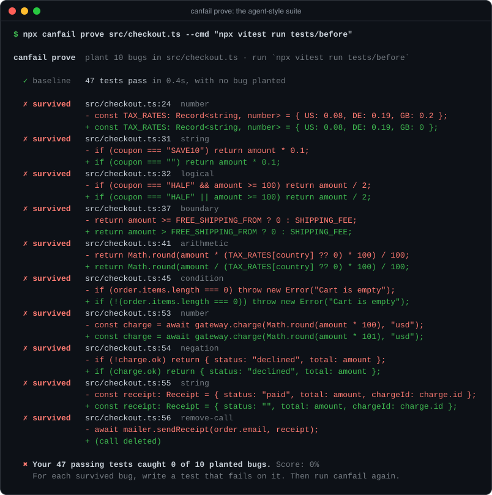
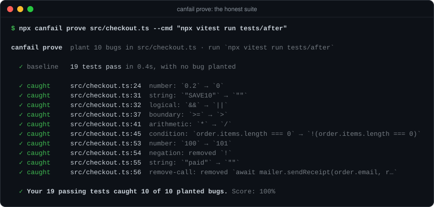
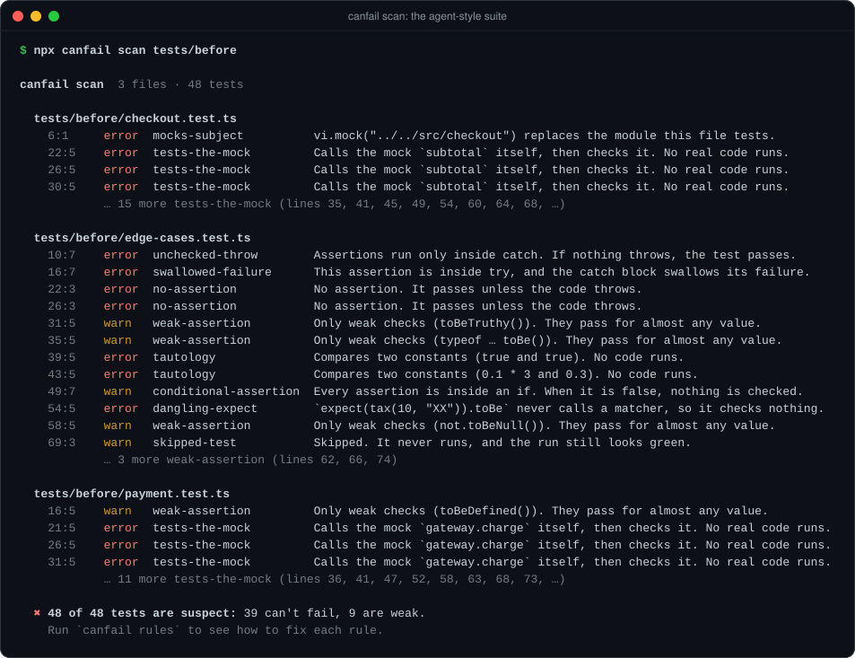
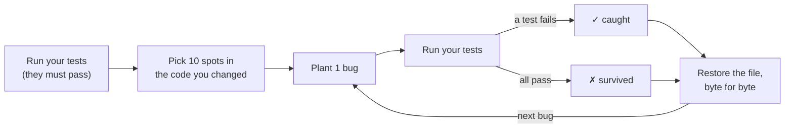

<p align="center">
  
</p>

<h1 align="center">canfail</h1>

<p align="center">
  <strong>Your agent says all tests pass. canfail checks if they can fail.</strong><br>
  A skill and a zero-config checker that stop AI agents from writing fake tests.
</p>

<p align="center">
  <a href="https://github.com/ykakade/canfail/actions/workflows/ci.yml"></a>
  
  
  
</p>

<h3 align="center">"My agent's 47 passing tests caught 0 of 10 planted bugs."</h3>

<p align="center">
  That line is real canfail output. Run <code>npm run demo</code> and you get it too.<br>
  The 47 tests in the demo copy the patterns that agents write most. Each one looks fine on its own.<br>
  <a href="#the-demo">See the run</a> &middot; <a href="#install">Install in 30 seconds</a> &middot; <a href="#canfail-on-canfail">canfail on its own tests</a>
</p>

---

## The problem

You ask an agent for tests. It writes 47 of them. They are green. It reports: **"All tests pass."**

Then you read them. The agent mocked the module it was supposed to test. It called its own mocks and checked that it had called them. It wrapped one assertion in a `try/catch` that swallows the failure. And it skipped the one test that failed.

Every test passes, because no test **can** fail. Coverage does not see the problem: the lines ran. Code review does not see it either: 47 green tests look like work.

canfail sees it. It plants real bugs in your code, runs your tests, and counts the bugs the tests catch.

<p align="center">
  
</p>

## How it works

canfail has two parts, like [ponytail](https://github.com/DietrichGebert/ponytail) and [impeccable](https://github.com/pbakaus/impeccable): a **skill** that changes how the agent writes tests, and a **checker** that proves the result.

| Part | What it does | When it runs |
|---|---|---|
| **The skill** | Seven rules the agent follows when it writes tests. Mock only the boundary. Assert exact values. Never edit an expected value to match the output. Never skip a red test. | Every time the agent touches a test |
| **`canfail scan`** | Reads the test files and flags 12 patterns of tests that can't fail. Static, about one second, runs nothing. | Before `prove`, and in the hook |
| **`canfail prove`** | Plants one bug at a time in the code you changed, runs your test command, and counts the catches. | Before the agent says "done" |
| **The hook** | In Claude Code, scans each test file the moment the agent writes it. A fake test goes straight back to the agent with the reason. | After each `Write` or `Edit` |

This is what the agent sees when it writes a fake test (real hook output):

```text
canfail: edge-cases.test.ts has tests that can't fail.
- line 10: [unchecked-throw] Assertions run only inside catch. If nothing throws, the test passes.
- line 16: [swallowed-failure] This assertion is inside try, and the catch block swallows its failure.
- line 22: [no-assertion] No assertion. It passes unless the code throws.
- line 26: [no-assertion] No assertion. It passes unless the code throws.
- line 39: [tautology] Compares two constants (true and true). No code runs.
- line 43: [tautology] Compares two constants (0.1 * 3 and 0.3). No code runs.
- line 54: [dangling-expect] `expect(tax(10, "XX")).toBe` never calls a matcher, so it checks nothing.
Fix them before you report that tests pass. Mock only boundaries, call the real code, assert exact values.
Run `canfail rules` for fixes, and `canfail prove` to count the bugs your tests catch.
```

The agent reads this right after the write. It can fix the test before it reports back to you.

The skill also makes the agent **report a number**, not a feeling:

```diff
- All tests pass! ✅
+ Tests: 19 pass. canfail scan: 0 errors. canfail prove: caught 10 of 10 planted bugs.
```

## Install

**Claude Code** (skill + hook). Run these as two separate prompts:

```
/plugin marketplace add ykakade/canfail
```
```
/plugin install canfail@canfail
```

**Codex, Cursor, Copilot, Gemini CLI, OpenCode and other agents** (skill):

```bash
npx skills add ykakade/canfail
```

**Any agent without skills:** copy [`AGENTS.md`](AGENTS.md) into your project. It holds the same rules in 20 lines.

**Only the checker,** in a terminal or in CI. It needs Node 18 or later, and nothing else:

```bash
npx github:ykakade/canfail
```

Then ask your agent for tests as usual. The skill does the rest.

## The demo

Same code, two test suites, the same 10 planted bugs. The code is a [checkout module](examples/checkout/src/checkout.ts): subtotal, coupons, shipping, tax, and a card charge.

| Test suite | Tests | Green? | `canfail scan` | Bugs caught |
|---|---:|:---:|---|---:|
| [Agent-style](examples/checkout/tests/before) | 47 pass, 1 skipped | ✅ | 48 of 48 suspect | **0 of 10** |
| [Honest](examples/checkout/tests/after/checkout.test.ts) | 19 pass | ✅ | 0 findings | **10 of 10** |

The agent-style suite uses the patterns agents write most: it mocks the module under test, it checks mocks it called itself, and it uses `toBeDefined()` where an exact value belongs. Each test looks fine on its own. The honest suite fakes only the card processor and the mail server, and asserts exact values that were worked out by hand. It has fewer tests, and it catches every bug. With `--bugs all`, it catches all 44 bugs canfail can plant in that file.

<p align="center">
  
</p>

Run it yourself. It takes about 10 seconds:

```bash
git clone https://github.com/ykakade/canfail && cd canfail
npm install
npm run demo
```

A test in this repo checks these numbers on every push. If the demo changes, CI fails. The README cannot drift from the truth.

## What `scan` catches

<p align="center">
  
</p>

| Rule | It looks like this | Why it can't fail |
|---|---|---|
| `mocks-subject` | `vi.mock("./cart")` in `cart.test.ts` | Every call goes to the mock, not to your code. |
| `everything-mocked` | every project import is mocked | No real code runs at all. |
| `tests-the-mock` | `send("hi"); expect(send).toHaveBeenCalled()` | The test checks a call it made itself. |
| `no-assertion` | `it("works", () => { total(cart) })` | It only fails if the code throws. |
| `tautology` | `expect(true).toBe(true)` | It compares constants. |
| `dangling-expect` | `expect(x).toBeTruthy` (no `()`) | A property read checks nothing. |
| `swallowed-failure` | `try { expect(…) } catch {}` | The catch eats the assertion error. |
| `unchecked-throw` | `expect` only inside `catch` | If the code stops throwing, the test still passes. |
| `floating-assertion` | `expect(p).resolves…` with no `await` | The test ends before the check runs. |
| `skipped-test` ⚠️ | `it.skip(…)` | It never runs, and the run is still green. |
| `weak-assertion` ⚠️ | `toBeDefined()`, `typeof x === "number"` | It passes for almost any value. |
| `conditional-assertion` ⚠️ | `if (x) expect(…)` | When `x` is false, nothing is checked. |

⚠️ = warning. Run `canfail rules` for the fix of each rule. The full catalog with bad and good examples is in [`skills/canfail/references/fake-tests.md`](skills/canfail/references/fake-tests.md).

`scan` reads Vitest, Jest, Mocha, Chai, `node:test` with `node:assert`, and AVA. It finds suspects. `prove` gets the confession.

## What `prove` does



1. canfail runs your test command once. It must pass, or canfail stops.
2. It reads the source files you changed (from git) that your tests reach. It finds every place where a bug fits.
3. It picks 10 of them. The pick spreads over bug types and lines, and the same seed gives the same pick.
4. For each bug, it edits the file, runs the tests, and puts the file back.
5. A failing run means **caught**. A green run means **survived**: your tests cannot see that bug.

The bugs are the small mistakes that real code has:

| Bug type | Example |
|---|---|
| boundary | `amount >= 100` → `amount > 100` |
| equality | `===` → `!==` |
| logical | `&&` → `\|\|` |
| arithmetic | `price * qty` → `price / qty` |
| condition | `if (paid)` → `if (!(paid))` |
| negation | `if (!charge.ok)` → `if (charge.ok)` |
| number | `0.2` → `0`, `100` → `101` |
| string | `"usd"` → `""` |
| boolean | `true` → `false` |
| method | `Math.max` → `Math.min`, `.some` → `.every` |
| update | `i++` → `i--` |
| remove-call | `await mailer.sendReceipt(…)` → *(deleted)* |

canfail does not plant bugs in imports, types, log calls or error messages. Mark a line with `// canfail-ignore` to skip it.

**Safety:** canfail writes a journal of each file before it plants a bug. It restores the file after each run, on Ctrl-C, and on a crash. If you `kill -9` it, run `canfail restore`. Tests in this repo send real signals to the process to check this.

## canfail on canfail

A tool that checks tests must pass its own check. So we pointed `canfail prove` at its own source, with its own tests. The first result was bad.

| Round | Our tests | Bugs caught | What canfail showed us |
|---|---:|---:|---|
| 1 | 53 | **20 of 40** (50%) | Half the bugs survived. A message test never sat on its 48-character boundary. A timeout used `Math.max`, and no test would see `Math.min`. |
| 2 | 72 | **29 of 40** (73%) | No test for class property names, `obj["key"]` strings, `.then().catch()` chains, or the SIGTERM handler. |
| 3 | 76 | **29 of 40** (73%) | No test for mocks assigned in `beforeEach`, CommonJS `require`, or assertions in a ternary. |
| 4 | 83 | **28 of 40** (70%) | No test for `mock.module` (node:test, Bun), AVA's `t.is` and `t.snapshot`, or `import * as api` mocks. |
| 5 | 86 | **crash** | canfail crashed while it planted bugs in its own source. See below. Before the crash, 7 bugs survived in the bug picker. |

Each round plants *new* bugs. When the code changes, the same seed picks new spots, so no round can be passed by memory. Rounds 1 to 4 used seed 1 and round 5 used seed 2026.

What we learned:

- **61 bugs survived across the rounds.** We fixed each one with a new test, or by deleting the code.
- **16 parts of the code could never change a result.** canfail found them because no test could tell them apart from a bug. We deleted them. Less code, more checks.
- **One real bug that no test had found.** The table of method swaps (`min`/`max`, `some`/`every`) was a plain object. So a call to `chunk.toString()` found `Object.prototype.toString`, and canfail planted a function as text and crashed. Any project that calls `.toString()` would have hit it. It is a `Map` now, with a test.

Run it yourself: `npm run prove:self`.

## Use it in CI

```yaml
# .github/workflows/tests.yml
- uses: actions/checkout@v4
  with: { fetch-depth: 0 }
- run: npm ci
- run: npx github:ykakade/canfail --bugs 20 --min-score 80
```

Exit code `0` means no fake tests and enough bugs caught. `1` means fake tests or too many survivors. `2` means canfail could not run, for example because the tests already fail.

<details>
<summary><b>All options</b></summary>

```
canfail [test paths]        scan, then prove
canfail scan [test paths]   find tests that can't fail. Static, no test run.
canfail prove [src paths]   plant bugs in source files, run the tests, count the catches
canfail rules               list the scan rules and how to fix each one
canfail restore             put back source files after a killed run

--cmd <command>      test command (default: npm test). {file} becomes the mutated file
--files <a,b,...>    source files for prove (default: changed files the tests reach,
                     else the files the tests import)
--bugs <n|all>       how many bugs to plant (default: 10)
--seed <n>           pick a different set of bugs (default: 1)
--timeout <ms>       time limit per test run (default: 3x baseline, at least 10s)
--min-score <0-100>  pass when at least this % of bugs are caught (default: 100)
--json               print JSON for tools and agents
```

Faster runs: use `{file}` to run only the tests that import the changed file, for example `--cmd "npx vitest related {file} --run"` or `--cmd "npx jest --findRelatedTests {file}"`.

</details>

## How it compares

| | Coverage | [Stryker](https://stryker-mutator.io) | canfail |
|---|---|---|---|
| Question it answers | Did this line run? | Do the tests catch bugs, in the whole project? | Do the tests catch bugs in the code you just changed? |
| Setup | a flag | a config file and a runner plugin | none |
| Typical run | seconds | minutes or more | seconds |
| Made for | people | people and CI | agents: a skill, a hook, `--json`, exit codes |
| Finds a test that checks its own mock | no | yes, in the score | yes, by name, before any run |

canfail does not replace Stryker. Stryker is the full audit. canfail is the quick check an agent can run 20 times a day.

## FAQ

**Is this mutation testing?**
Yes, a small and fast form of it. canfail plants 10 bugs, not 10,000, in the files you changed, not in the whole project.

**Does it change my code?**
Only during a run, one bug at a time. It restores each file byte for byte. See [Safety](#what-prove-does).

**Which test runners work?**
`prove` works with any command that exits with a non-zero code when a test fails: Vitest, Jest, Mocha, `node --test`, Bun, Playwright, and others. `scan` reads JavaScript and TypeScript test files.

**I use ts-jest with type checks. Does that matter?**
Yes. A planted bug can cause a type error. ts-jest then fails the run, and canfail counts the bug as caught. Turn on `isolatedModules`, or use a runner that does not type-check (Vitest, `@swc/jest`).

**A bug survived, but it does not change behavior. Now what?**
That is an *equivalent mutant*. For example, `x >= 0` and `x > 0` are the same when `x` is never 0. Often the line is dead code: delete it. If not, mark it with `// canfail-ignore` and say why.

**Why does the agent not just game canfail?**
To catch a planted bug, a test must fail when the code is wrong. That is the definition of a real test. There is no cheaper way to pass.

**Why "canfail"?**
It is the one question every test must answer with yes.

## Contributing

Issues and pull requests are welcome. Before you open a pull request, run:

```bash
npm test && npm run typecheck && npm run prove:self
```

Every new rule needs a test that shows a fake test it flags, and a real test it does not flag.

## License

[MIT](LICENSE)
