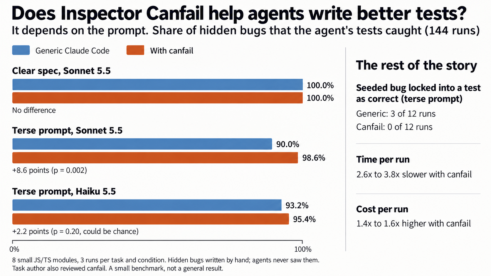

# Benchmark

Does canfail help Claude Code write tests that catch more bugs? It depends on the prompt.



## Results

| Experiment | Runs | Bugs caught, generic | Bugs caught, canfail | Runs that caught all bugs | p |
|---|---:|---:|---:|---:|---:|
| Clear spec, Sonnet 5.5 | 48 | 219/219 (100.0%) | 219/219 (100.0%) | 18/18 and 18/18 | 1.0 |
| Terse prompt, Sonnet 5.5 | 48 | 197/219 (90.0%) | 216/219 (98.6%) | 7/18 and 15/18 | 0.002 |
| Terse prompt, Haiku 5.5 | 48 | 204/219 (93.2%) | 209/219 (95.4%) | 7/18 and 9/18 | 0.20 |

The p value is from a permutation test inside each task. The Haiku result can be chance.

**Bugs already in the code.** Two tasks have a bug in the code that contradicts the requirements.

| Experiment | Generic: found | Generic: wrote the bug into a test as correct | Canfail: found | Canfail: wrote the bug into a test as correct |
|---|---:|---:|---:|---:|
| Clear spec, Sonnet 5.5 | 6/6 | 0 | 6/6 | 0 |
| Terse prompt, Sonnet 5.5 | 4/6 | 2 | 6/6 | 0 |
| Terse prompt, Haiku 5.5 | 4/6 | 1 | 6/6 | 0 |

With the terse prompts together, that is 8 of 12 against 12 of 12 found (p = 0.09, so not certain).

**The cost.**

| Experiment | Time per run, generic | Time per run, canfail | Cost per run, generic | Cost per run, canfail |
|---|---:|---:|---:|---:|
| Clear spec, Sonnet 5.5 | 18s | 60s | $0.072 | $0.108 |
| Terse prompt, Sonnet 5.5 | 13s | 50s | $0.056 | $0.088 |
| Terse prompt, Haiku 5.5 | 17s | 44s | $0.005 | $0.007 |

The image and the tables above use canfail 0.1.0, because only that version ran next to the generic group.

## Canfail 0.2.0

We ran the canfail group again on 0.2.0, with the same tasks. We did not run the generic group again, so this comparison is not controlled.

| Experiment | Bugs caught, generic | 0.1.0 | 0.2.0 | Seeded bug found, 0.1.0 | Seeded bug found, 0.2.0 | Time per run, 0.1.0 | Time per run, 0.2.0 |
|---|---:|---:|---:|---:|---:|---:|---:|
| Clear spec, Sonnet 5.5 | 100.0% | 100.0% | 100.0% | 6/6 | 6/6 | 60s | 87s |
| Terse prompt, Sonnet 5.5 | 90.0% | 98.6% | 99.5% | 6/6 | 5/6 | 50s | 64s |
| Terse prompt, Haiku 5.5 | 93.2% | 95.4% | 95.9% | 6/6 | 5/6 | 44s | 57s |

The change in bugs caught is too small to be sure of. Version 0.2.0 is slower: more clean runs and a reach check give more trustworthy results, and they take more time. Compared with the generic group, a run takes about 3.4 to 4.9 times longer. In one Haiku run on 0.2.0, the agent wrote the seeded bug into a test as correct. The rerun used the scan hook, but not the new stop hook. Later changes to the scanner, which remove false alarms, came after this rerun.

## Scanner on real projects

We ran the old and the new scanner on the same files at the same time: 17,822 test files in Emdash, Theia, Forge, and Orca.

| | 0.1.0 | 0.2.0 |
|---|---:|---:|
| Errors | 587 | 263 |
| Warnings | 707 | 698 |

Causes that we removed: Playwright hooks reported as tests (64), valid Chai assertions (49), and two calls compared with each other (45, now warnings). We did not review all 263 remaining errors. Of these, 154 are `no-assertion`, and many of those tests use helpers from other files, which canfail does not follow. These are false alarms.

## What did not go well for canfail

- With a clear spec, canfail added no measurable value. It made the runs about 3 times slower.
- With a clear spec, all 3 generic runs on the CSV task found a real bug that we did not plant: the parser drops a row that holds only `""`. None of the 3 canfail runs found it. The canfail runs wrote about half as many tests on that task (14 against 27). The skill tells agents to avoid repeated cases, which may be the cause, but 3 runs cannot show that.
- Haiku opened the skill in only 4 of 24 runs. It ran `scan` in 10 and `prove` in 8. A skill that does not start cannot help. This may be why its gain is small.

## Method

The [protocol](../benchmark/PROTOCOL.md) was written before the runs. Experiment 2 was added after Experiment 1 tied, and its plan was also written before it ran. It is exploratory.

- **Groups.** The model, tools, files, and prompt are the same. The canfail group also has the skill and the scan hook in `.claude/`. No group has user settings or MCP servers.
- **Tasks.** 6 modules with no known bug and 2 modules with a planted bug: pricing, a rate limiter, payment retries, a CSV parser, access rules, inventory, loyalty points, and a password policy. Each task and group has 3 runs.
- **Score.** 73 bugs written by hand. Agents do not see them, and they do not come from canfail's mutation list. A bug is caught when a test that passes on the correct code fails on the bugged code.
- **Checks.** A reference test suite passes on the correct code and catches every bug. This check found 3 bad bugs before the first run, and we corrected them. A weak control suite scores 0 of 12 and 3 of 12, so the scorer can give low scores.

## Limits

- The sample is small: 8 small modules, one language, 3 runs for each cell.
- The author of the tasks also reviewed canfail and knew what it does.
- The benchmark used no real repository, so it says nothing about large projects.
- The prompts are examples. A different prompt can give a different result.

## Run it

```bash
cd benchmark
node setup.mjs                     # checks the tasks and installs the test tools in /tmp/wk
node run.mjs v1 3 6                # 48 runs, 6 at a time. About $4.
node score.mjs v1
TERSE=1 MODEL=claude-haiku-5-5 node run.mjs x2h 3 5
node score.mjs x2h
node stats.mjs                     # uses the labels v1, x2s and x2h
```

If a run fails, as with a usage limit, the runner stops and the scorer refuses the results. Run the same command again to finish.
